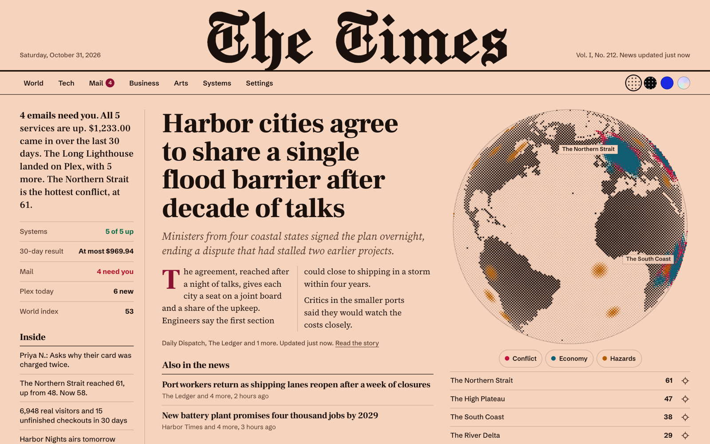
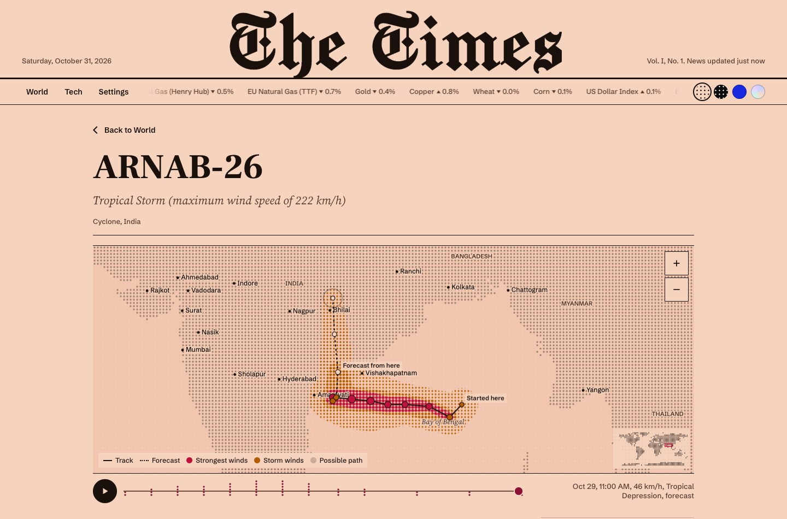
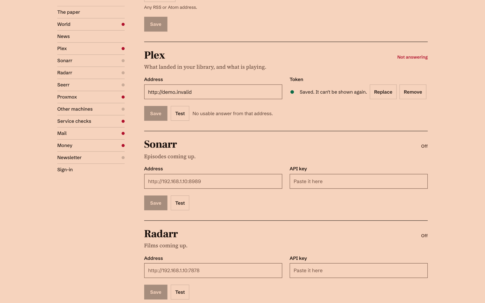

# Halftone

A private morning newspaper you run yourself. It opens with real news from more than 60 outlets, live scores, weather and a live globe of the world's conflicts, with no keys and no accounts. Connect your mail, money, media and servers and they join the same page.



Stories open inside the paper, in a clean reader. The globe, charts and meters are all printed in dots, and there are four themes: Morning, Night, Cobalt and Glass. Call it what you like and set the title in blackletter, like a real masthead, or in one of four other faces.

Every story gets told in its own way. A cyclone draws its track across a map you can scrub through time, with its wind swath, forecast path and the people in its way. An earthquake's shaking spreads from the epicentre. A conflict plays back report by report, and a story shows which outlets carried it and when, and what each one led with. Every map has real place names and a small world in the corner, so you always know where you are.



The front page comes from `tools/demo.py`, where every name and number is made up.

## Run it

You need Docker.

```sh
git clone https://github.com/Neoo-Blue/halftone
cd halftone
docker compose up -d
docker compose logs paper
```

The log prints a one-time setup code. Open <http://localhost:8095>, enter the code and choose a password. The first news edition takes about two minutes to arrive, then it refreshes every three.

Everything else is in **Settings**.

To look around first, with no Docker and no setup, run `python3 tools/demo.py` and open <http://127.0.0.1:8096>.

**Kubernetes:** `kubectl apply -f deploy/kubernetes.yaml` gives you a Deployment, a Service and a 2 GB PersistentVolumeClaim. Keep it at one replica on local or block storage, because the database is SQLite. The file's first lines cover the setup code and keys.

**Proxmox:** run Docker in an LXC and use the steps above. Enable nesting on the container.

**Updating:** `docker compose pull && docker compose up -d`. Your settings and history stay in the `paper-data` volume.

## What you can connect

Leave anything blank and it stays off the page.

| Desk | Connect | What you get |
|---|---|---|
| News | Nothing | More than 60 outlets, grouped by story and ranked by how many carry it, with search and what's trending today. Add your own feeds |
| Sports | Nothing | Live scores and results for the leagues you choose, and the sports wire |
| Weather | A place name | Now, the next 48 hours and the week ahead |
| World | Nothing | The [WARROOM public API](docs/warroom-api.md): globe, conflict desk, forecasts, hazards, space weather |
| Mail | Microsoft 365 app, optional Anthropic key | Read-only triage across your mailboxes. Money, customer, security and legal mail rises to the top |
| Business | Any address returning [the money report](docs/money-feed.md) | Are you making money? Sales minus costs, by product |
| Investments | Nothing, or [a portfolio address](docs/portfolio-feed.md) | Type in what you hold and it's priced for you. Total, gain and loss on the front page, your holdings on the tape, which you can customize |
| AI use | An AI provider, or [any of these](docs/ai-use.md) | What your AI used each day, what it was worth at list price, and what was really charged |
| Arts | Plex, optional Sonarr, Radarr and Seerr | What landed, what's playing, what's coming |
| Systems | Proxmox, SSH, or plain addresses | Service checks, containers, storage and backups, 30 days of history for every machine, and a list of what needs you, including downloads that stuck, certificates about to run out and jobs that stopped checking in |



Name the paper and choose its title face, from blackletter like a real masthead to the theme's own. Each connection has a Test button that tells you in plain words what went wrong. Saved keys can never be read back, not even by you. Any setting can come from the environment instead: see `.env.example`.

## Yours to arrange

Press Arrange to move sections up or down. Each screen size keeps its own order, because a phone is read differently from a desk. Turn on Learn from what I read under Layout, and after every 2 hours of reading the sections you spend the most time in move up. The paper says what moved, and Undo puts it back.

Press a or tap the button in the corner to ask the paper a question beside what you're reading. Press / to search and t to change the theme. Add the paper to a phone's home screen and it opens like an app.

Stories you open are remembered on the server, not in a browser, so one you read on your phone isn't new on your desk. Saved stories follow you too. Add an alert address under Settings, ntfy or anything that takes a POST, and something serious reaches you without opening the paper.

## Reading it

Follow a name or subject and its stories get their own place on the front page. Mute one and it leaves the paper, the lead and old editions included. Do either from a topic page, or under Settings.

Every day's edition is kept under Back issues, so a story that scrolled away can still be found. A story page says which outlets carry it, flags claims nobody has confirmed yet, and has an Ask button with Explain this simply, What led to this? and Who disagrees? On a wide screen the story takes most of the page, set in newspaper columns in short blocks, so you never scroll back up to find the next column. A narrow column beside it holds how the story spread, others on the same subject and the day's top stories, and stays in view as you read.

Listen reads a story aloud in your device's own voice for free, or in a natural voice through LiveKit or Deepgram. Choose the service under Settings and pick from its voices, with a button to hear each one first. Audio is kept, so hearing a story twice costs once, and the voice services count under AI use.

The last edition stays readable when your server or connection is down, with a line saying it may be old. That copy is held in the browser that signed in, it goes when the session ends, and after three days it stops being offered.

## Every conflict from day one

Each WARROOM theater has a timeline back to where it began, with a source on every entry. A rail shows how far through it you are as you read.

## Watching your machines

Every machine gets its own page: CPU, disk wait, memory, disk, network, disk activity, load and temperature, over the last hour, day, week or month, with its volumes and what's using it most right now. The paper warns you before a disk fills, and when a machine stays busy for an hour, not only when something has already gone wrong.

For work no address can see, like backups and scheduled scripts, name the job under Job check-ins and have it call in when it finishes. If it goes quiet, or never starts, the paper says so.

Where the script's user can read Docker, the machine's page lists its containers and flags any that keep restarting or fail a health check. Being in the docker group amounts to root on that machine, so that's your call.

Proxmox connects with a read-only token. For any other Linux box, a NAS or a cloud server, copy `agent/stats.sh` to it and lock an SSH key to that one script: the first lines of the file show how. Older copies of the script keep working, but network, disk activity and top processes need the current one.

## AI

Add any provider in Settings: Anthropic, OpenAI, Google Gemini, xAI Grok, OpenRouter, Groq, Mistral, DeepSeek, Together, Ollama, LM Studio, or anything OpenAI-compatible. You can then ask the paper questions, have your mail sorted, set it up by describing what you want, and read a note it writes itself every few hours.

Any AI can also read the paper, over MCP or plain HTTP, with a token you control. Only news and world are shared until you tick more. [docs/ai.md](docs/ai.md) has the setup for Claude, Cursor and the rest, and explains why the AI that reads strangers' words can never change a setting.

## Putting it on the internet

`compose.yaml` publishes the paper on this machine only. Before you change that, read [SECURITY.md](SECURITY.md). In short:

- Put a tunnel or a TLS reverse proxy in front of it. Plain HTTP sends your password in the clear.
- Have the proxy send `X-Forwarded-Proto: https`, so the session cookie is marked Secure.
- If your proxy already has its own login, you can set `PAPER_AUTH=none` and name the hostname in `PAPER_HOSTS`. Without a gate of your own, leave sign-in on.

Back up the `paper-data` volume, and treat that backup like your keys.

## How it works

One Python process, stdlib apart from the Anthropic SDK that mail sorting uses. Background jobs snapshot each source into SQLite and the page only reads those snapshots, so a slow or dead source can't slow the paper down: it shows the last good copy and how old it is. The front end is plain ES modules with no build step.

```sh
python3 tests/test_paper.py   # the logic that can quietly lie: money, sanitizing, secrets, sign-in
python3 paper/server.py       # needs PAPER_DATA set to a folder you can write to
```

`DESIGN.md` describes the design system.

## License

MIT. The fonts in `web/fonts` are under the SIL Open Font License: see `web/fonts/LICENSE.md`.

World data comes from WARROOM and is free to use with attribution. Headlines belong to their publishers.
