# Halftone

A private morning newspaper you run yourself. It opens with real news from nearly 60 outlets, live scores and a live globe of the world's conflicts, with no keys and no accounts. Give it a town for the weather, connect your mail, money, media and servers, and they join the same page.


- **Stories told in their own way.** A cyclone is a track you can scrub through time, a war plays back report by report, and everything opens inside the paper in a clean reader.
- **Both sides.** Who is carrying each story from left to right, what only one side is running, and the case each side makes.
- **Search past the paper.** A stock, a team, a town and a war each come back in their own form, with the web beside them.
- **Follow anything.** Whatever you follow gets a card on the front page, in that same form, kept up to date.
- **Every conflict from day one.** A timeline back to where it began, and who is saying what today.
- **Election watch.** When a vote is near, a desk appears that says which seat decides it and what to watch. When it's over, the desk is gone.
- **Your own desks.** The mail that needs you, whether you're making money, your investments, your AI bill, your Plex library and your servers.
- **A real app on your phone.** One desk at a time, swiped between, with what you reach for under your thumb.
- **Any AI, or none.** The paper works without one. Add any provider to ask it questions, or let your own AI read the paper.

Every picture on this page comes from `tools/demo.py`, where every name, number and story is made up. You can run it yourself in a minute.

## Run it

You need Docker.

```sh
git clone https://github.com/Neoo-Blue/halftone
cd halftone
docker compose up -d
docker compose logs paper
```

The log prints a one-time setup code. Open <http://localhost:8095>, enter the code and choose a password. The first edition arrives within a minute or two, and the news refreshes every three minutes after that.

Everything else is in **Settings**.

To look around first, with no Docker and no setup, run `python3 tools/demo.py` and open <http://127.0.0.1:8096>. Every desk is filled in, and nothing leaves your machine.

**Kubernetes:** `kubectl apply -f deploy/kubernetes.yaml` gives you a Deployment, a Service and a 2 GB PersistentVolumeClaim. Keep it at one replica on local or block storage, because the database is SQLite. The file's first lines cover the setup code and keys.

**Proxmox:** run Docker in an LXC and use the steps above. Enable nesting on the container.

**Updating:** `docker compose pull && docker compose up -d`. Your settings and history stay in the `paper-data` volume.

## Every story in its own way

Stories open inside the paper, in a clean reader. A cyclone draws its track across a map you can scrub through time, with its wind swath, forecast path and the people in its way. An earthquake's shaking spreads from the epicentre. A conflict plays back report by report, and a story shows which outlets carried it and when, and what each one led with. Every map has real place names, and on a wider screen a small world in the corner, so you always know where you are.


The globe, the meters and most charts are printed in dots. So are photographs, and a tap brings a story's photo back to full colour. A note at the top of the front page says what needs you, built from your own numbers with no AI, and an Inside list points to it. With an AI connected, an editor's note says what to read first. Since you were here says what's new when you come back, and Trending shows what everyone is writing about today.

## Reading it

Follow a name or subject and its stories get their own place on the front page. Mute one and it leaves the news, the lead and old editions included, though the world desk still reports it. Do either from a topic page, or under Settings.

Every day's edition is kept for 400 days under Back issues, so a story that scrolled away can still be found. A story page says which outlets carry it and in which countries, how long it takes to read, and has an Ask button with Explain this simply, What led to this? and Who disagrees? On a wide screen the story takes most of the page, set in newspaper columns in short blocks, so you never scroll back up to find the next column. A narrow column beside it holds how the story spread, others on the same subject and the day's top stories, and stays in view as you read.

Select any word in a story to have it explained, a currency or a name you don't know. Catch me up says what happened while you were away, and Play today's paper reads you the note and the top stories.

Listen reads a story aloud in your device's own voice for free, or in a natural voice through LiveKit or Deepgram. Choose the service under Settings and pick from its voices, with a button to hear each one first. Audio is kept, so hearing a story twice costs once, and the voice services count under AI use.

Stories you open are remembered on the server, not in a browser, so one you read on your phone isn't new on your desk. Saved stories follow you too.

The last edition's front page and desks stay readable when your server or connection is down, with a line saying they may be old. Opening a story still needs a connection. That copy is held in the browser that signed in, it goes when the session ends, and after three days it stops being offered.

## Both sides

Once two rated outlets carry a story, it shows who is carrying it, on a bar from left to right, with the same thing said in words. A story page sets the two most different headlines side by side. Where there's a real dispute, it says what's being argued over, how many outlets are for and against, and the case each side makes, written by AI from the coverage and marked as such. Nothing gets invented for a story that has no dispute.

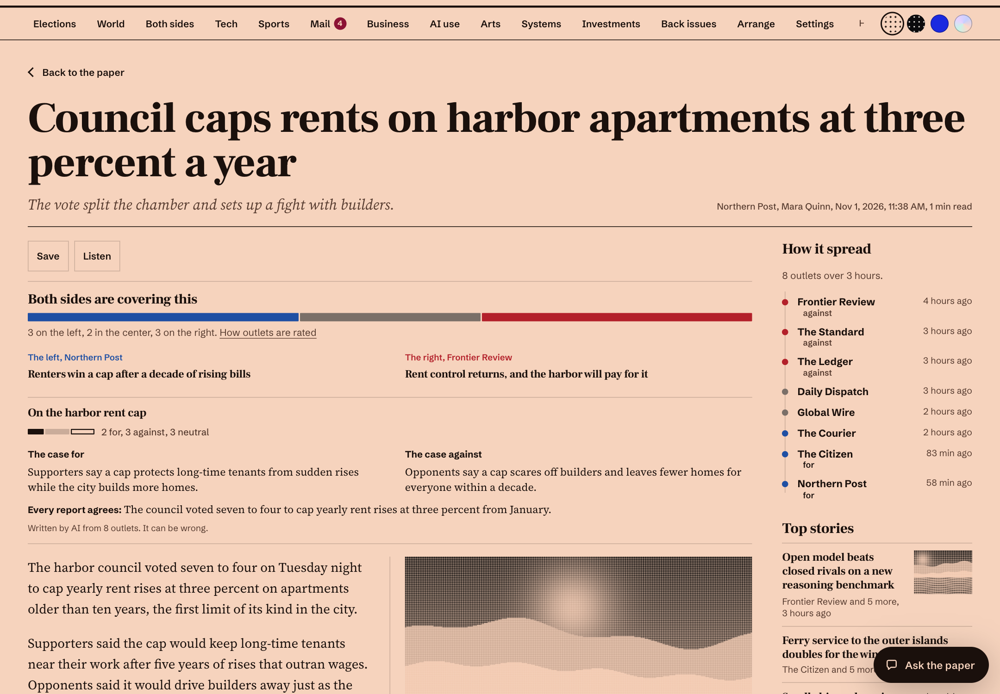

A story that only one side is running lands on the Both sides desk. It only counts once it's had three hours to reach the other side and nothing there matches it, because each side writes its own headlines. The desk also shows which way your own reading has leaned over 30 days.

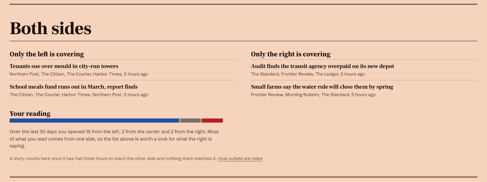

Ratings are about an outlet's overall slant, not one story. They ship as a starting point drawn from where the public bias charts broadly agree, and Settings lets you overrule any of them. Most outlets abroad and the trade press aren't rated, because an American left and right doesn't describe them. How outlets are rated, linked from every story, lists them all beside your own reading.

## Search, and following anything

Search reaches past the paper. As you type it offers what the paper already knows. On the results page it works out what the words are, then shows them the way that kind of thing is best read: a stock with its price and month, a team with its last result and next game, a town with its forecast, a conflict with who is reporting it, and anything else with its encyclopedia entry. Below that come the paper's own stories, the web, what the betting markets expect, more reporting, what people are saying now, research and code.

With an AI connected, an answer sits at the top with each claim numbered to its source, and three questions you might ask next. Ask more and it reads the same sources again, and says so when they don't have the answer.

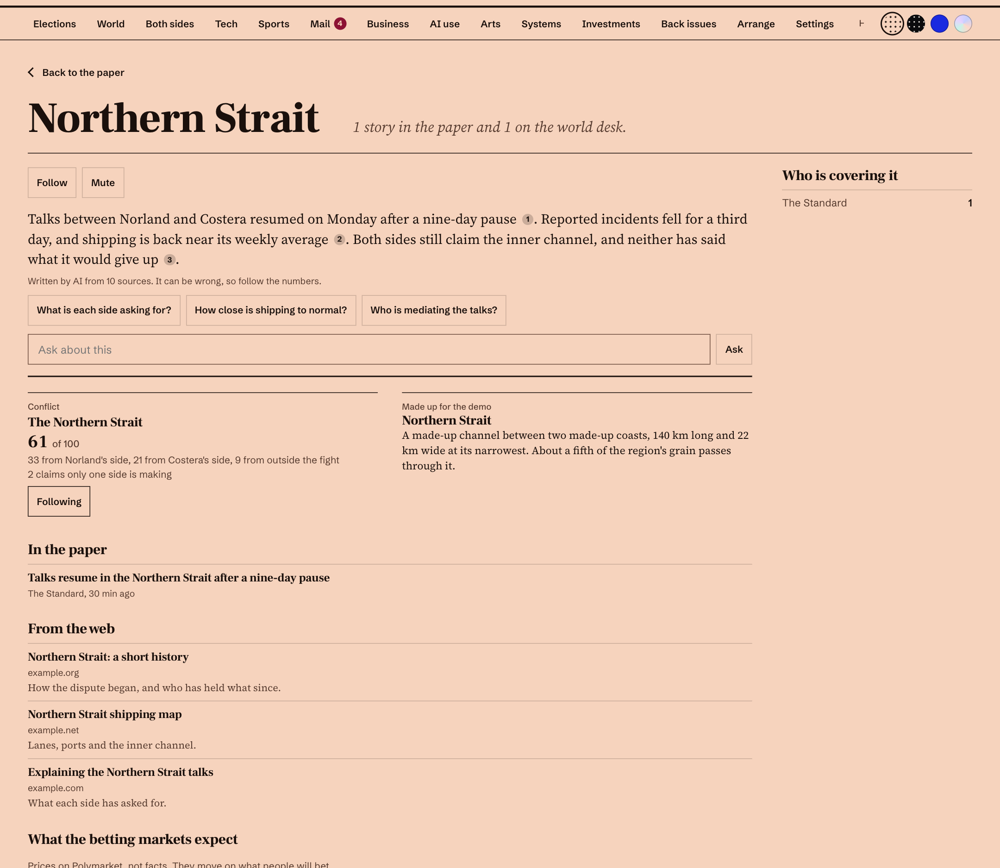

Press Follow and it takes its own place on the front page, in that same form, kept up to date. A stock keeps its price and month, a team its last result and next game, a town its forecast, a war who is reporting it, and a subject its newest stories, with a count of what's new since you last looked. The front page shows the first 12, and you can follow up to 40 on the Following page.

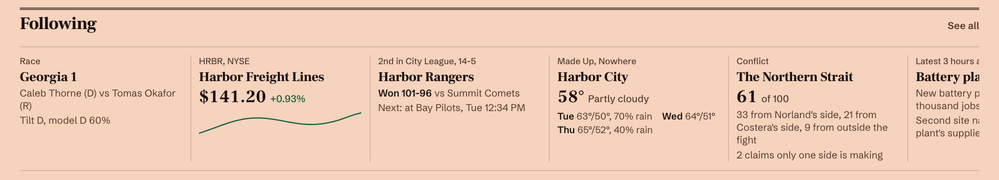

None of this needs a key: Wikipedia, Bing News, Hacker News, arXiv, GitHub, Polymarket, Yahoo Finance, ESPN and Open-Meteo all answer without one. For the open web, use Anthropic's search if that's your AI provider (about a cent a search), a SearXNG of your own, or Brave Search. Under Search in Settings, one switch turns the free sources off and one choice picks the web search.

## The world desk

The world comes from [WARROOM's public API](docs/warroom-api.md), free and with no key. The desk has the escalation index and why it stands where it does, the odds for the next hours, what surged this week, open disaster alerts, space weather, and how many ships, aircraft and satellites are being tracked.

Drag the globe or use the arrow keys to turn it, tap a dot to open the report, and switch Conflict, Economy and Hazards on and off. A report's page has its place, who was involved, its sources, what else happened nearby and the article. Run your own WARROOM and the desk adds What matters today and a table of markets.

## Every conflict from day one

Most WARROOM theaters have a timeline back to where they began, with a source on every entry. A rail shows how far through it you are as you read.

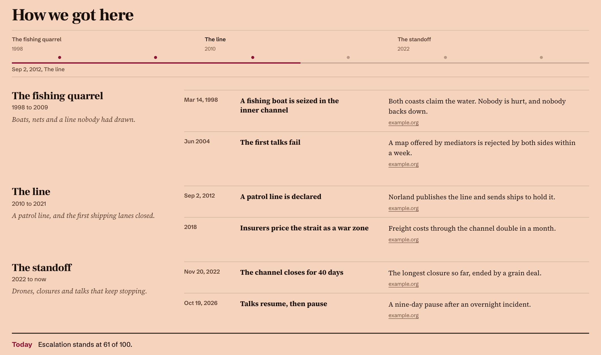

Most of what reaches a war map is one side's word, so each conflict says who is reporting it. It counts the last three days by each side of the fight, voices outside it, and voices nobody can place. It lists what only one side is saying and what both sides report, and gives each side's account, written by AI and marked as what that side claims rather than what happened. Each report opens with a line that says the same, like "Both sides report this" or "Measured by an instrument".

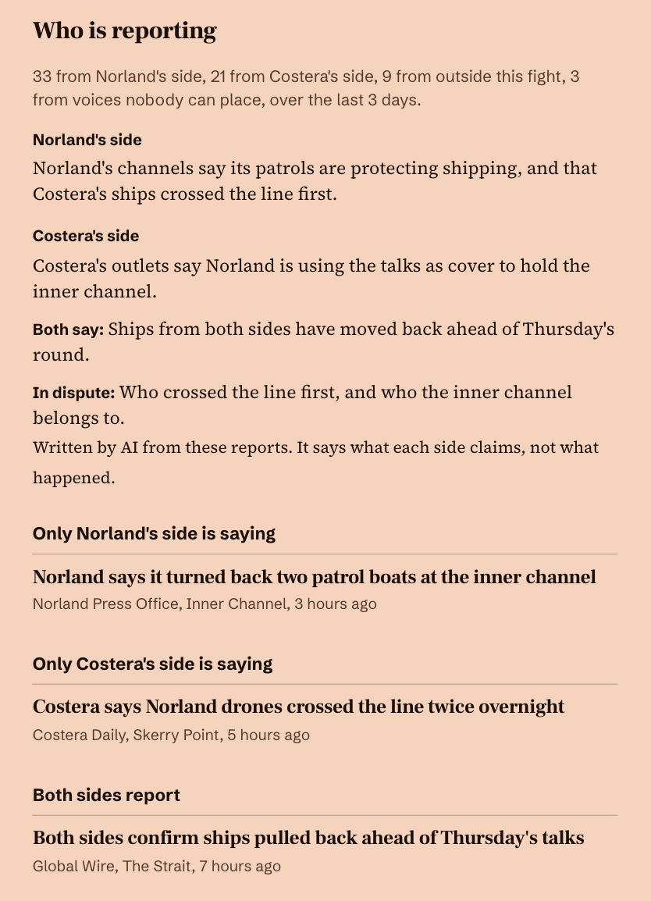

## Election watch

When a vote is near, a desk appears at the top of the paper. When it's over, the desk leaves on its own, with its place in the menu. A US election shows from two months before to two weeks after, and a vote abroad from two weeks before to a week after. Nothing needs setting up: it comes with the world desk.

It starts from what you'd ask, not from a table of numbers. Which seat decides each chamber: rank every race by how likely a party is to win it, count down to a majority, and that's the tipping point. Which seats look like changing hands. Where models, polls, forecasters and bettors disagree, because that's where a race is less settled than one number makes it look. And how the night will go, hour by hour in your own time, with the closest races as each batch of polls closes.

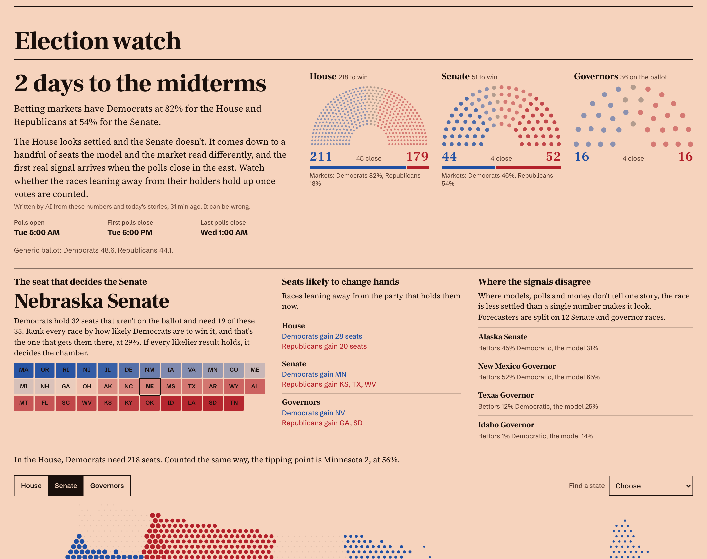

The map is printed like the rest of the paper. A state's dots grow with how sure its race is, so a safe seat reads solid and a toss-up barely prints, and you can switch between the Senate, governors and the House.

Every race has its own page. It says in plain words who has it, who holds the seat, whether it's open, and how near it is to the tipping point. Every signal sits on one scale, so you can see at a glance whether they agree. Then come each poll and, with an AI connected, what the race is actually about, written from the reporting with numbered sources. Follow a race and it joins the front page.

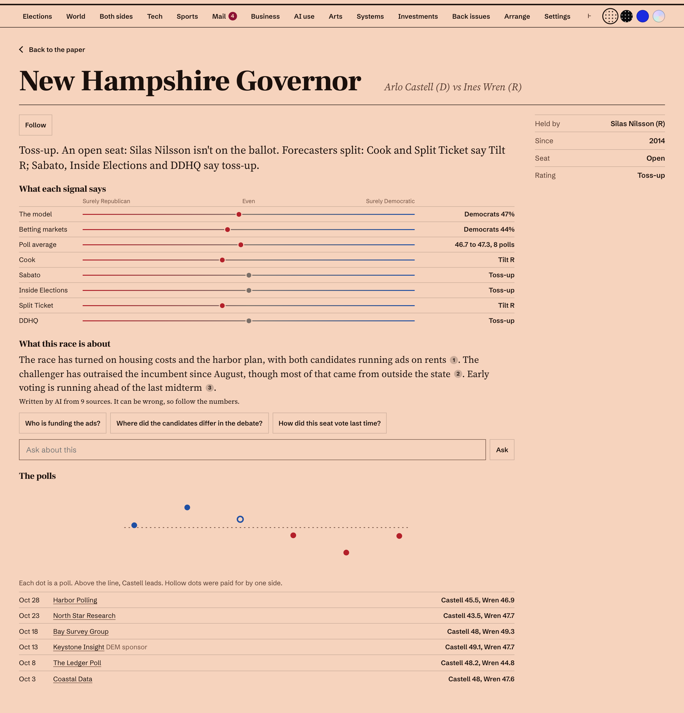

On the night it follows the count. The numbers turn into what's been called, the map fills in, and a race that's still open says how many votes are left and what share of them the trailing candidate needs. That's an estimate from the share counted, and the page says so. Abroad, each vote gets its date, its stage, the result when there is one, and what it's about.

All of it comes from WARROOM's public API, which credits its sources: civicAPI, Polymarket, The New York Times, VoteHub, IFES ElectionGuide and the forecasters it relays.

## On a phone

On a phone the paper reads one desk at a time, and you swipe between them. A bar under your thumb has Today, Search, Ask, Saved and More. In a story it changes to Back, Listen, Ask, Save and Share, and the coverage folds to a single bar until you open it. More holds text size and a theme that matches your phone. Add the paper to your home screen and it opens like an app.

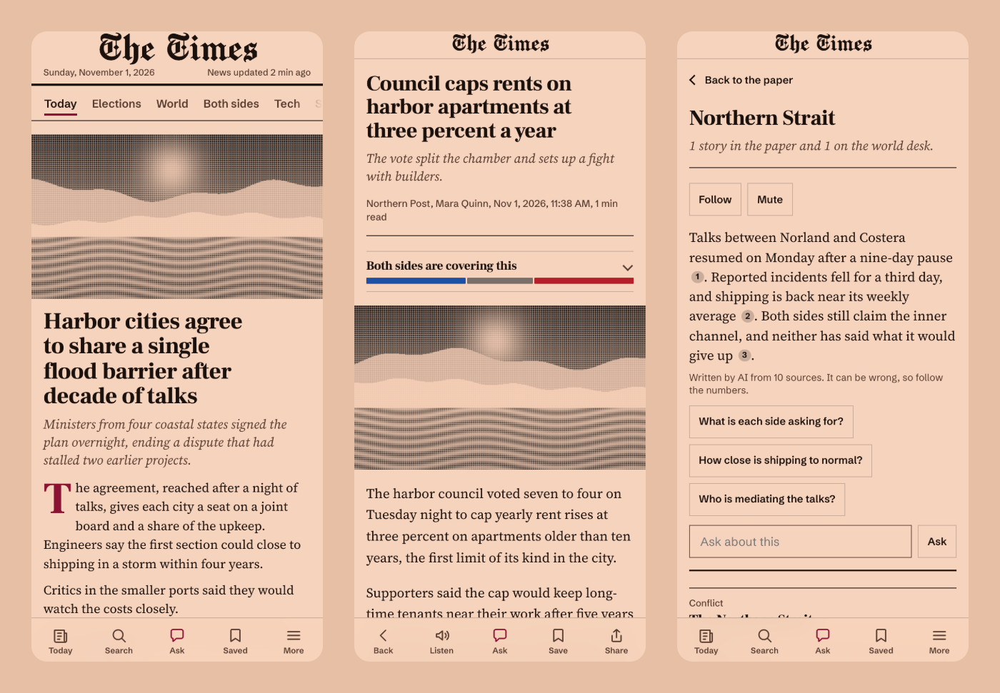

## What you can connect

Leave anything blank and it stays off the page.

| Desk | Connect | What you get |
|---|---|---|
| News | Nothing | Nearly 60 outlets, grouped by story and ranked by how many carry it, with search and what's trending today, and 24 more that count toward who is covering a story. Add your own feeds |
| Tech | Nothing | Its own lead, and a wire you can filter by AI, Tech, Security and Science |
| Sports | Nothing | Live scores and results for any of twelve leagues, and the sports wire |
| Weather | A place name | Now, the next 48 hours and the week ahead, with feels-like, wind, sunrise, and when rain is likely |
| World | Nothing | The [WARROOM public API](docs/warroom-api.md): globe, conflict desk, who is reporting each war, election watch, forecasts, hazards, space weather |
| Mail | Microsoft 365 app, optional AI provider | Read-only triage across your mailboxes. Money, customer, security and legal mail rises to the top |
| Business | Any address returning [the money report](docs/money-feed.md) | Are you making money? Sales minus costs, by product |
| Investments | Nothing, or [a portfolio address](docs/portfolio-feed.md) | Type in what you hold and it's priced for you. Total, gain and loss on the front page, your holdings on the tape, which you can customize |
| AI use | An AI provider, or [any of these](docs/ai-use.md) | What your AI used each day, what it was worth at list price, and what was really charged |
| Arts | Plex, optional Sonarr, Radarr and Seerr | What landed, what's playing, what's coming |
| Systems | Proxmox, SSH, or plain addresses | Service checks, containers, storage and backups, 30 days of history for every machine, and a list of what needs you, including downloads that stuck, certificates about to run out and jobs that stopped checking in |

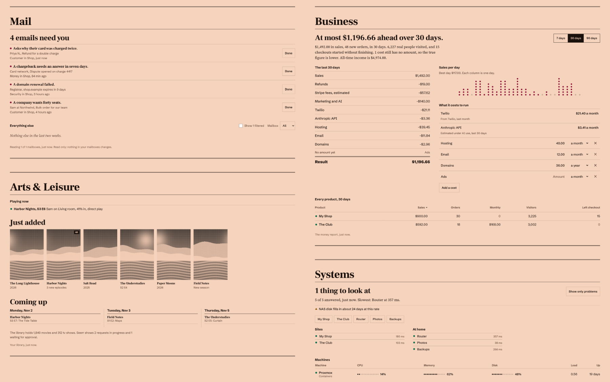

- **Mail** opens as plain text with links and images off, and Done changes only the paper, never the mailbox. The spam folder is read too, so a real customer isn't lost there.
- **Business** has a 7, 30 or 90 day view, running costs you can edit, and a page for each product. Twilio, Deepgram and your AI use fill in their own bills.
- **Investments** works as a watch list too: a symbol with no shares, crypto, and foreign stocks in dollars. With nothing set up, the tape runs the S&P 500, Nasdaq, Dow, VIX, gold, oil, Bitcoin and EUR/USD.
- **Arts** opens each title with its cast, the seasons you've watched, its picture and sound, and Play in Plex.
- **Systems** can show only problems, and gives every service a page with seven days of uptime and every container a page of its own.

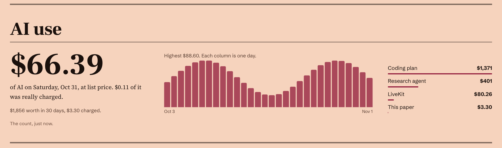

Name the paper and choose its title face, from blackletter like a real masthead to the theme's own. Most connections have a Test button that tells you in plain words what went wrong. Saved keys can never be read back, not even by you. Any setting can come from the environment instead: `.env.example` lists the common ones, and a list goes in as JSON.


## Yours to arrange

There are four themes: Morning, Night, Cobalt and Glass. Press t to change theme, or pick one at the top of the page. Until you choose, it follows your device or the time of day.

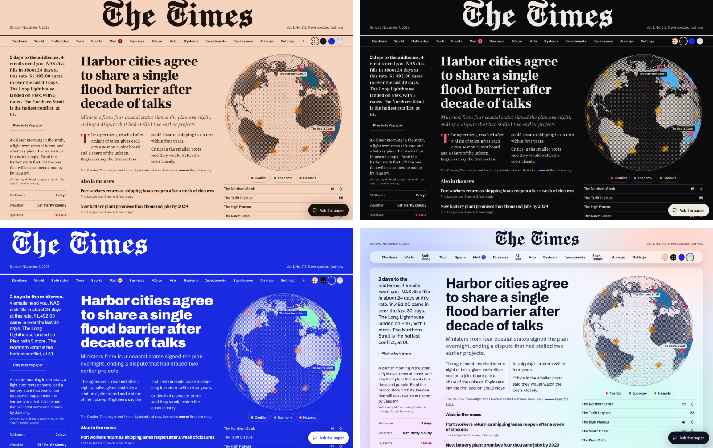

Press Arrange to move sections up or down. Each screen size keeps its own order, because a phone is read differently from a desk. Turn on Learn from what I read under Layout, and after every 2 hours of reading the sections you spend the most time in move up. The paper says what moved, and Undo puts it back.

Tap the button in the corner to ask the paper a question beside what you're reading. On the front page, press a to do the same, and / to search.

Add an alert address under Settings, ntfy or anything that takes a POST, and trouble on your systems reaches you without opening the paper: a service or machine down, a disk nearly full, a failed backup, a RAID or ZFS fault, a certificate about to run out, or a job gone quiet. You get one message per new problem.

## Watching your machines

Every machine gets its own page: CPU, disk wait, memory, disk, network, disk activity, load and temperature, over the last hour, day, week or month, drawn as dots, lines, areas or columns, with its volumes and what's using it most right now. The paper warns you before a disk fills, and when a machine stays busy for an hour, not only when something has already gone wrong.

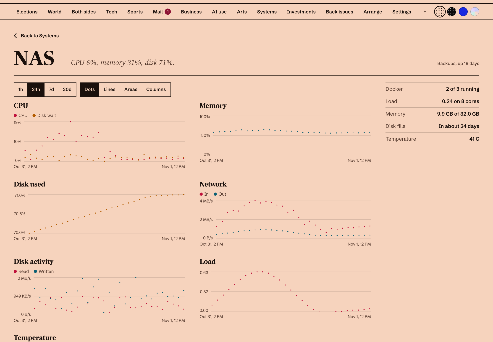

For work no address can see, like backups and scheduled scripts, name the job under Job check-ins and have it call in when it finishes. If it goes quiet, or never starts, the paper says so.

Where the script's user can read Docker, the machine's page lists its containers and flags any that keep restarting or fail a health check. Being in the docker group amounts to root on that machine, so that's your call.

Proxmox connects with a read-only token. For any other Linux box, a NAS or a cloud server, copy `agent/stats.sh` to it and lock an SSH key to that one script: the first lines of the file show how. Older copies of the script keep working, but network, disk activity and top processes need the current one. A Proxmox host's token alone doesn't give temperature, disk activity, volumes or top processes, so run the script there too if you want them.

## AI

The paper works without one. News, scores, the world desk, search results, the coverage bars and Listen in your device's own voice all need no AI.

Add any provider in Settings: Anthropic, OpenAI, Google Gemini, xAI Grok, OpenRouter, Groq, Mistral, DeepSeek, Together, Ollama, LM Studio, or anything OpenAI-compatible. That turns on Ask, Explain, Catch me up, the editor's note every few hours, the answer at the top of a search, what an election race is about, the case for and against, and mail sorted beyond its built-in rules.

Ask starts with questions that fit what you've connected, reads the story you have open, and can only answer. At the top of Settings, describe your setup in your own words and it proposes the changes, with each old value beside the new one. Nothing changes until you press Apply, and you type any keys yourself.

Each kind of AI work has a daily ceiling, so a busy day can't run up the bill: 200 questions, 400 emails sorted, 60 web searches, 150 search answers, 60 story comparisons, and 150,000 characters of Listen.

Any AI can also read the paper, over MCP or plain HTTP, with a token you control. News, world, elections, weather and sports are shared, and money, media, systems and mail only once you tick them. It's read only. [docs/ai.md](docs/ai.md) has the setup for Claude, Cursor and the rest, and explains why the AI that reads strangers' words can never change a setting.

## Putting it on the internet

`compose.yaml` publishes the paper on this machine only. Before you change that, read [SECURITY.md](SECURITY.md). In short:

- Put a tunnel or a TLS reverse proxy in front of it. Plain HTTP sends your password in the clear.
- Have the proxy send `X-Forwarded-Proto: https`, so the session cookie is marked Secure.
- If your proxy already has its own login, you can set `PAPER_AUTH=none` and name the hostname in `PAPER_HOSTS`. Without a gate of your own, leave sign-in on.

Back up the `paper-data` volume, and treat that backup like your keys.

## How it works

One Python process. Background jobs snapshot each source into SQLite and the front page only reads those snapshots, so a slow or dead source can't slow it down: it shows the last good copy and how old it is. Detail pages, like a report or a story, fetch when you open them. The front end is plain ES modules with no build step.

```sh
python3 tests/test_paper.py   # the logic that can quietly lie: money, sanitizing, secrets, sign-in
python3 paper/server.py       # needs PAPER_DATA set to a folder you can write to
```

`DESIGN.md` describes the design system. To retake the pictures here, run the demo, then `node tools/shots.cjs`, which needs `playwright-core` and Chrome.

## License

MIT. The fonts in `web/fonts` are under the SIL Open Font License: see `web/fonts/LICENSE.md`.

World data comes from WARROOM and is free to use with attribution. Headlines belong to their publishers.
